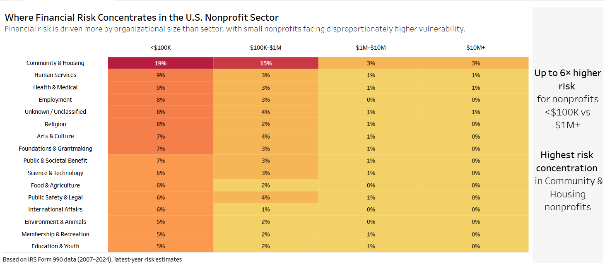
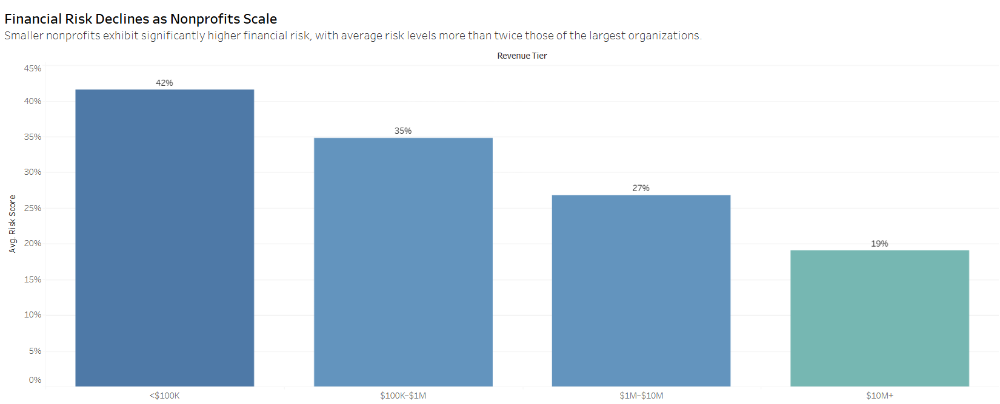
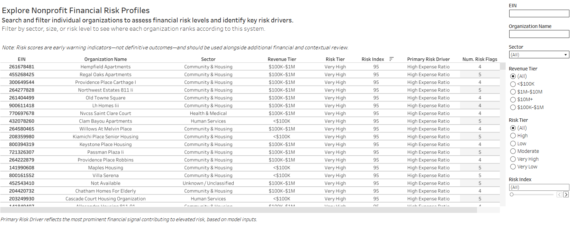

# Nonprofit Financial Sustainability Risk Index (NFSRI)

A data-driven framework for exploring financial vulnerability among U.S. nonprofit organizations using historical IRS Form 990 data. The project combines predictive modeling, financial warning indicators, and interactive visualization to examine patterns of financial distress and support further investigation.

---

## Overview

Nonprofit organizations play a critical role in delivering essential services across the United States, yet many operate with limited financial buffers and are vulnerable to economic shocks.

The **Nonprofit Financial Sustainability Risk Index (NFSRI)** was developed to:

- Identify organizations at elevated financial risk  
- Surface early warning signals of financial distress  
- Provide interpretable financial warning indicators to support further investigation

**The goal is to move beyond descriptive reporting and create a practical decision-support tool for funders, policymakers, and researchers.**

---

## Tableau Dashboard

[Tableau Public Dashboard Here](https://public.tableau.com/app/profile/precious.o.enahoro/viz/USNonprofitFinancialSustainabilityRiskIndexNFSRI/FinancialRiskConcentration)

The dashboard provides:

- Sector- and size-level risk patterns  
- Risk distribution and trends over time  
- Financial warning indicators and risk patterns
- Organization-level exploration of risk profiles  

**Important Note:**  
*Risk scores represent early warning indicators, not definitive outcomes. They should be used alongside qualitative and contextual information when making decisions.*

---
## Dashboard Preview







---
## Key Findings

-  Smaller nonprofits (<$100K revenue) exhibit significantly higher risk levels  
- Most nonprofits fall into moderate risk categories, with a smaller high-risk segment  
- **Common financial stress signals include:**
  - High expense ratios  
  - Low or negative operating margins  
  - Declining assets  
  - Declining revenue  

---

## Methodology

**Data:**  
[IRS Form 990 data (2007–2024)](https://990data.givingtuesday.org/datamarts/?co-item=basic-fields-679696bc141dbd17de689e0f)

### Step 1: Feature Engineering

Organization-level financial indicators were constructed, including:

- Operating margin  
- Expense ratio  
- Revenue and asset trends  
- Organizational scale (by revenue)  


### Step 2: Modeling

- Machine learning model to predict the likelihood of financial distress  
- Outputs transformed into a **standardized risk index (0–100)**  


### Step 3: Interpretation & Actionable Insights

To improve usability, the model is paired with an interpretable, organization-level layer that translates risk scores into actionable insights.

Each organization is enriched with:

- **Risk tiers** (Low → Very High)  
- **Driver flags** (e.g., high expense ratios, low margins, declining assets or revenue)  
- **Primary risk driver classification**  
- **Number of risk signals triggered**  

In addition, the project includes an **organization-level risk explorer**, enabling users to:

- Identify high-risk nonprofits  
- Examine the financial warning indicators associated with an organization's risk profile.
- Filter by sector, size, and risk level  

Together, these components provide an exploratory financial-risk assessment framework that can help users identify patterns and prioritize questions for further investigation.

---

## Potential Impact

Financial instability in the nonprofit sector can disrupt the delivery of essential services, particularly in areas such as housing, education, and health.

This project introduces a **scalable, data-driven framework** for identifying financially vulnerable organizations, with potential applications across:

- **Philanthropy and grantmaking**  
  → Potentially helping funders identify financial indicators that warrant additional due diligence or consideration of organizational capacity-building needs, rather than making automated funding recommendations.

- **Public policy and oversight**  
  → Supporting agencies in monitoring sector-wide financial health and identifying systemic vulnerabilities  

- **Research and sector analysis**  
  → Providing a structured approach to studying financial resilience across nonprofit organizations  

By combining predictive modeling with interpretable financial signals, the NFSRI demonstrates how publicly available data can be leveraged to improve transparency and strengthen decision-making in the nonprofit ecosystem.

---

## Use Cases

This tool is intended to support:

- **Foundations & grantmakers**  
  → Identify financially vulnerable organizations and prioritize support  

- **Policymakers & agencies**  
  → Monitor systemic risk across the nonprofit sector  

- **Researchers & analysts**  
  → Study financial health and structural challenges in nonprofits  

---
## Limitations and Responsible Use

The NFSRI is an exploratory analytical framework intended to identify patterns of financial vulnerability among U.S. nonprofit organizations. While it provides a structured approach to assessing financial indicators, several limitations should be considered when interpreting its results.

### 1. Historical Financial Data
The analysis relies on IRS Form 990 data covering 2007–2024. These filings may not reflect an organization's current financial condition, liquidity, operational challenges, or recent changes in funding.

### 2. Model Performance and Predictive Uncertainty
The XGBoost model achieved an ROC-AUC of approximately 0.69 on the evaluation dataset, indicating some ability to distinguish observations meeting the study's financial-distress definition from those that did not.

However, this performance does not establish that the model can reliably predict nonprofit closure, insolvency, or long-term organizational failure.

### 3. Risk Score Interpretation
Risk scores are derived from model-generated probabilities and expressed on a 0–100 scale. The scores have not been established as calibrated probabilities of future financial distress.

The five risk tiers (Very Low to Very High) are based on relative percentile groupings within the analyzed dataset rather than externally validated risk thresholds.

Consequently, a score of 80 should not be interpreted as an 80% probability that an organization will experience financial distress.

### 4. Financial Warning Flags and Risk Drivers
The framework includes rule-based financial warning flags, such as low operating margins, high expense ratios, and declining assets or revenue.

These indicators identify financial conditions that may warrant further investigation. They are not causal explanations of financial distress or model-derived explanations of individual risk predictions.

The primary risk driver classification is a descriptive designation based on predefined rules, rather than an explanation generated by the predictive model.

### 5. Organizational and Data Differences
Nonprofit organizations differ in mission, size, revenue structure, accounting practices, and operating environments. Similar financial indicators may have different implications across organizations.

Sector classification is also incomplete for some organizations, which may affect comparisons across nonprofit categories.

### 6. Financial Risk Is Not Organizational Effectiveness
Elevated financial risk does not necessarily indicate poor organizational management, ineffective programs, or limited social impact.

Financially vulnerable organizations may serve communities with substantial unmet needs. The NFSRI should not be used to determine whether an organization is deserving of funding or support.

### 7. Operational Validation
The NFSRI has not been validated as an operational decision-making tool for nonprofit financial management, grantmaking, or investment decisions.

Its public availability demonstrates dissemination of the analytical framework, not adoption or demonstrated improvements in organizational decisions.

### Responsible Use
The NFSRI should be used to support exploratory analysis, comparative research, and further investigation of financial conditions.

Results should be interpreted alongside additional financial documentation, organizational context, and appropriate professional judgment.

**Risk scores should not be used as the sole basis for funding decisions, assessments of organizational effectiveness, or predictions of nonprofit failure.**


*Future iterations can incorporate more recent data and expanded feature sets to improve accuracy and coverage.*

---
## Future Improvements

1. Evaluate model calibration and assess the reliability of risk-score interpretation.
2. Conduct additional validation across nonprofit sectors, organizational sizes, and time periods.
3. Incorporate more recent financial data and expand sector classification coverage.
4. Obtain feedback from nonprofit finance professionals, researchers, and grantmaking practitioners to evaluate the framework's practical relevance.
5. Improve organization-level interpretation, documentation, and dashboard usability based on validation findings.
    
---
## Repository Structure

```text
nonprofit-financial-risk-index/
│
├── data/
│   └── nfsri_latest_org_risk_profiles_v1 - Sample.csv        # Sample organization-level dataset
│
├── dashboard_outputs/
│   ├── cover.png              # Main dashboard preview
│   ├── size.png                 # Size vs risk visualization
│   └── explorer.png                   # Organization-level explorer view
│
├── sql/
│   ├── data_preprocessing_for_modelling.sql    # Data processing and joins
│   └── getting_nonprofit_sectors.sql       # Getting non-profit sectors
│
├── notebooks/
│   └── NFSRI_Model.ipynb     # Modeling and feature engineering
│
├── data_dictionary.md             # Variable definitions
│
└── README.md
```

```markdown id="getting_started"
## Getting Started

To explore the project:

1. View the interactive Tableau dashboard (link above)  
2. Review the sample dataset in `/data`  
3. Explore modeling and feature engineering in `/notebooks`  
4. Refer to `/data_dictionary.md` for variable definitions  

This repository is designed to provide both high-level insights and reproducible analysis components.

```
---

## Author Contribution

Designed and developed the full analytical pipeline, including:

- Data processing and feature engineering  
- Predictive modeling and validation  
- Risk scoring framework  
- Interpretation layer and driver flags  
- Tableau dashboard and organization-level explorer  

## Technologies Used

- Python (Pandas, NumPy, Scikit-learn)  
- SQL (data cleaning and feature engineering)  
- Tableau (data visualization and dashboarding)  
---

## Contact and Collaboration

- **Author**: Precious Enahoro  
- **GitHub**: @PreciousEnahoro
- **Linkedin**: (https://www.linkedin.com/in/precious-enahoro/)
